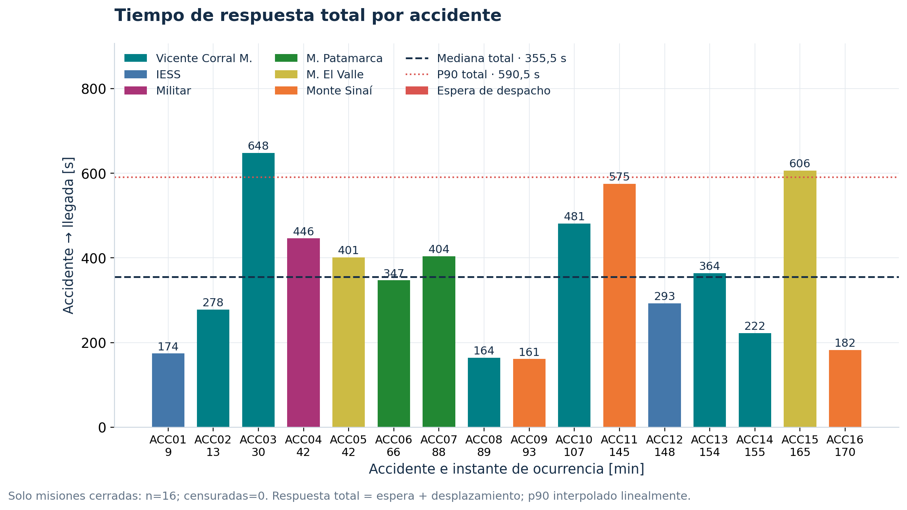

# Código de la Práctica 04

Este paquete conserva código, ZIP docente, coordenadas, informe y resultados ligeros. La red XML extraída, el OSM de coordenadas y los XML voluminosos de tráfico están en la entrega completa. Para recrear las entradas y ejecutar la auditoría en este repositorio:

```bash
python3 scripts/importar_red.py datos/docente/cuenca_net.zip
make reproducir
```

Consulta los requisitos de Docker, Python y Tectonic más abajo.

# Reto Ambulancias · Cuenca

Implementación reproducible del reto SUMO + TraCI de la guía docente adjunta.
Incluye código F0–F5, simulaciones ejecutadas, auditoría, extensión comparativa,
gráficas PNG/SVG/PDF e informe técnico.

**Autor:** Angel Ramiro Apolo Aguilar · Universidad de Cuenca · Ingeniería en
Telecomunicaciones · 10.º ciclo · Redes Vehiculares y Heterogéneas.
Correo: angel.apolo@ucuenca.edu.ec.

**Repositorio:** [angelrampolo/practica04-ambulancias-cuenca](https://github.com/angelrampolo/practica04-ambulancias-cuenca).

El informe final usa LaTeX con `IEEEtran`, doble columna y referencias numeradas.
La fuente editable está en [docs/latex/Informe_Reto_Ambulancias.tex](docs/latex/Informe_Reto_Ambulancias.tex).

**Abrir primero:** [informe PDF](docs/Informe_Reto_Ambulancias.pdf),
[resultados y validación](docs/RESULTADOS.md) y
[guía de comandos](docs/COMANDOS.md).

## Alcance de los datos

La red procede del ZIP docente incorporado el 26 de octubre de 2026.
Su recorte coincide con las 1.745 aristas y 176 semáforos de la guía.
El ZIP contiene únicamente la red; los puntos hospitalarios mantienen su
procedencia OpenStreetMap, documentada en `datos/hospitales.csv`.
Se ejecuta con SUMO **1.12.0**, disponible en la imagen local `van3twin:jammy`.

**A3 sigue parcial:** Patamarca está a 158,08 m del acceso utilizable, por encima
del límite de 150 m. Hace falta verificar su entrada o recibir la coordenada del
capítulo. La comprobación técnica en SUMO-GUI está realizada; la demostración
ante el docente corresponde al estudiante.

## Resultados principales, semilla 42

| Indicador | Valor medido |
|---|---:|
| Red de avenidas | 1.745 aristas, 176 semáforos |
| Demanda válida de fondo | 4.709 vehículos |
| Accidentes / misiones cerradas | 16 / 16 |
| Teletransportaciones | 0 |
| Flota inicial / final disponible | 10 / 10 |
| Mediana de respuesta total | 355,5 s |
| P90 de respuesta total | 590,5 s |
| Vehículos restantes al cierre | 0 |

Respuesta total = accidente → llegada; incluye espera por disponibilidad.
Las cifras se calculan en `scripts/analisis.py`; el detalle está en los CSV y
en `salida/principal/resumen.json`. No son tiempos medidos en emergencias reales.



## Reproducir

Desde esta carpeta, con Docker activo y la imagen `van3twin:jammy` existente:

```bash
python3 -m venv .venv
.venv/bin/python -m pip install -r requirements.txt
tectonic --version
python3 scripts/importar_red.py datos/docente/cuenca_net.zip
make reproducir PYTHON=.venv/bin/python
```

El Python del entorno virtual se usa para análisis y reportes. Dentro de Docker
se usa `python3`, con los módulos TraCI/sumolib de SUMO. La reproducción reutiliza
el mapa archivado: no descarga un mapa diferente ni afecta otros talleres.
Los resultados de esta carpeta se regeneran. La guía explica cada paso y sus
salidas, además de la visualización interactiva con `sumo-gui`.

El informe requiere [Tectonic](https://tectonic-typesetting.github.io/en-US/install.html)
(versión verificada: 0.16.9). En la primera compilación puede descargar paquetes
LaTeX. Si ya están instaladas las dependencias del anfitrión:

```bash
make reproducir
```

Para comprobar los resultados entregados sin volver a simular:

```bash
python3 scripts/validar.py --todos
python3 scripts/comprobar_repeticion.py
python3 -m unittest discover -s pruebas -v
```

## Organización

| Ruta | Contenido |
|---|---|
| `datos/` | OSM archivado, red completa, hospitales y procedencia |
| `escenario/` | Red de avenidas, demanda, tipos y configuración SUMO |
| `scripts/` | Preparación, controlador, experimentos, análisis y auditoría |
| `salida/base/` | Línea base sin TraCI y datos macro cada 15 min |
| `salida/principal/` | CSV, XML, logs, parámetros y validación de semilla 42 |
| `salida/cercano_*`, `salida/origen_*` | Comparación por semillas y carga 15/h |
| `salida/repeticion/` | Segunda ejecución para comparación exacta |
| `salida/modos/` | Experimento aislado de speedMode 31, 30, 23 y 0 |
| `salida/visual/` | Tres capturas de SUMO-GUI, estados TraCI y ejecución de la demo |
| `salida/fallos/` | Fallo interno de SUMO preservado, fuera de las comparaciones |
| `salida/figuras/`, `salida/tablas/` | Figuras exportables y tablas numéricas |
| `docs/` | Informe, resultados, comandos, método y diccionario de datos |
| `pruebas/` | Pruebas que detectan resultados deliberadamente corruptos |

## Criterios técnicos

La detección exige colisiones físicas registradas por SUMO. Las colas FIFO
conservan la identidad de cada unidad. El despacho usa tiempo de ruta agregado
y negativa probabilística explícita. La llegada distingue tres criterios y el
fin de ruta; la atención dura 120 s. El retorno restaura los tres controles de
SUMO. Los casos no cerrados siguen en los CSV como censurados.

Las comparaciones usan cinco semillas por política y muestran también los
casos desfavorables. No se mezclan esas réplicas con la repetición de control.
La semilla 7/origen falló dentro de SUMO 1.12; el log se conserva y se sustituyó
por la semilla 8 en ambas políticas antes de examinar sus resultados.
Ver [metodología completa](docs/METODOLOGIA.md) para fórmulas, fuentes,
limitaciones y diferencias frente a la guía.

Cartografía: © OpenStreetMap contributors, [ODbL](https://www.openstreetmap.org/copyright).

El archivo `Entrega_Reto_Ambulancias.zip` contiene la entrega completa. Su
inventario se verifica con `sha256sum -c MANIFEST.sha256` desde la raíz extraída.
Para regenerar el paquete después de cambiar archivos: `python3 scripts/empaquetar.py`.

Para demostrar el taller: `./scripts/demo_gui.sh`, con un visor VNC en
`localhost:5902`. Para preparar los archivos de publicación:
`python3 scripts/preparar_publicacion.py`. Revisa [ENTREGA.md](docs/ENTREGA.md)
antes de cargar el informe en Talleres. Fecha límite indicada por el estudiante:
**miércoles 28 de octubre de 2026, 20:00 (America/Guayaquil)**.
