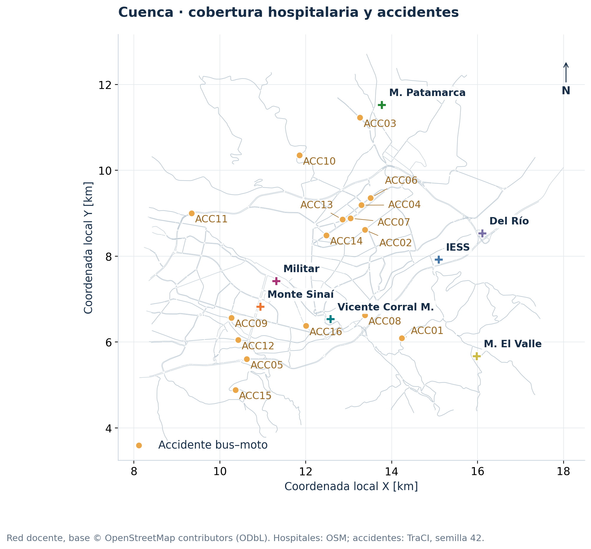
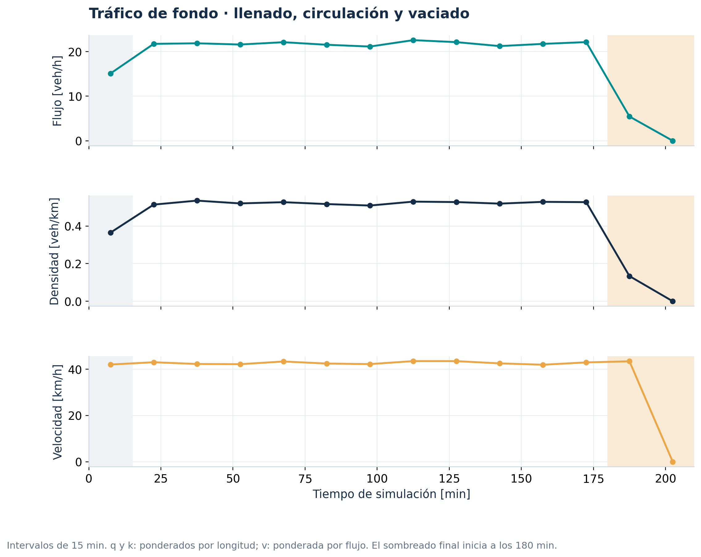
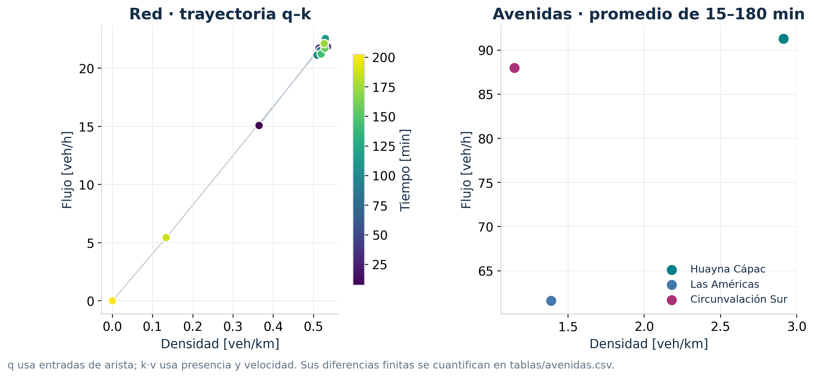
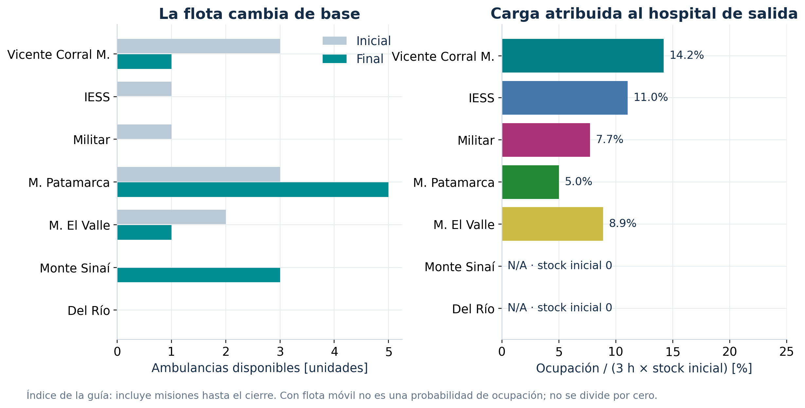
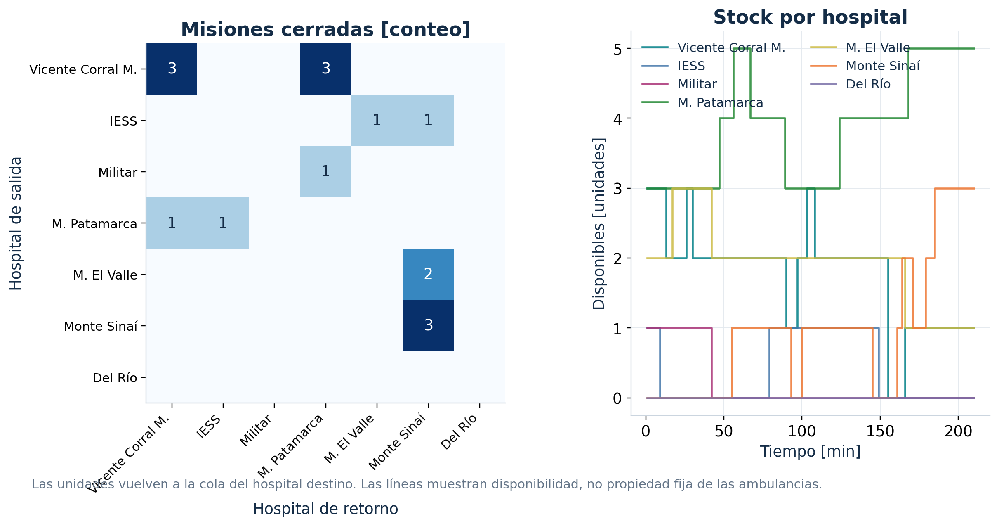
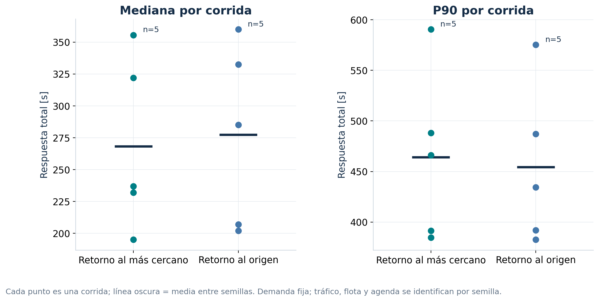
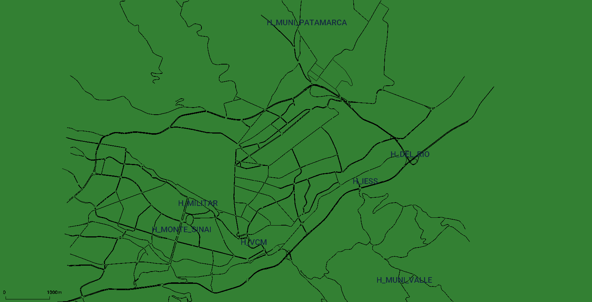
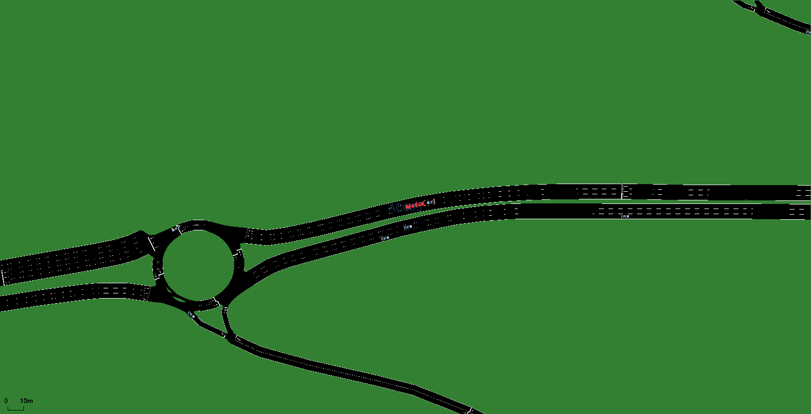
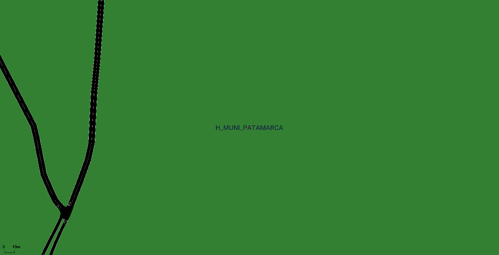

# Resultados y validación del reto


Ejecución principal: 2026-10-26 (UTC).


Angel Ramiro Apolo Aguilar · Universidad de Cuenca · Ingeniería en Telecomunicaciones · 10.º ciclo · Redes Vehiculares y Heterogéneas · angel.apolo@ucuenca.edu.ec

Semilla 42: 16 accidentes, 16 misiones cerradas y 0 censuradas; 0 teleports. Respuesta: media 359,1 s, mediana 355,5 s, p90 590,5 s y máximo 648,0 s. Espera media 0,0 s; mediana de misión 769,0 s. Flota inicial 10, disponible final 10; activos al corte 0, esperados 0.


## 01 · Escenario y procedencia


La red original del ZIP docente produce 1.745 aristas y 176 semáforos con los filtros del taller. El ZIP incluye únicamente cuenca_net.xml. Los puntos hospitalarios siguen procediendo de OSM y los tipos de vehículo son los implementados en este proyecto. SUMO 1.12.0. A3 pendiente: MUNI_PATAMARCA: 158.08 m. El límite es estrictamente menor de 150 m. Hace falta verificar el acceso o recibir la coordenada del capítulo. No se desplazaron puntos para aparentar cumplimiento.

ZIP y red conservan SHA-256. Un netconvert aplica jerarquía vial, bbox, mayor componente, simplificación y junctions.join-dist=25. km_arista suma vías dirigidas, no calles únicas.

| red | aristas | nodos | semaforos | km_arista | componentes_debiles |
| --- | --- | --- | --- | --- | --- |
| cuenca_net.xml | 34256 | 15405 | 337 | 3984.28 | 17 |
| cuenca_ciudad.net.xml | 1745 | 1009 | 176 | 355.56 | 1 |


## 02 · Control de acceso hospitalario


convertRoad con clase emergency, seguido de rutas de ida y vuelta. Los 49 pares se comprueban. Se conservan las proyecciones originales y las correcciones de conectividad.

A3 pendiente: MUNI_PATAMARCA: 158.08 m. El límite es estrictamente menor de 150 m. Hace falta verificar el acceso o recibir la coordenada del capítulo. No se desplazaron puntos para aparentar cumplimiento.

| Hospital | Vía asignada | Proyección [m] | Acceso útil [m] | Stock inicial |
| --- | --- | --- | --- | --- |
| VCM | Avenida Del Paraíso | 102,2 | 102,2 | 3 |
| IESS | Circunvalación Sur | 117,8 | 117,8 | 1 |
| MILITAR | Avenida 12 de Abril | 26,7 | 26,7 | 1 |
| MUNI_PATAMARCA | Via Checa Chiquintad | 158,1 | 158,1 | 3 |
| MUNI_VALLE |  | 54,8 | 54,8 | 2 |
| MONTE_SINAI | Avenida Fray Vicente Solano | 29,0 | 29,0 | 0 |
| DEL_RIO | Avenida de las Américas | 78,4 | 88,7 | 0 |


## 03 · Hospitales y accidentes


16 accidentes en 16 aristas. Red del ZIP docente; hospitales OSM; accidentes TraCI. Cartografía: © OpenStreetMap contributors.




## 04 · Línea base y tráfico


4709 vehículos insertados; 0 teleports; 9 colisiones de fondo; 0 activos al corte. Duración media 449.08 s. Demanda: 1.200 autos/h, 100 buses/h, 300 motos/h. Ventanas de 900 s; demanda hasta 180 min, vaciado hasta 210 min.




## 05 · Diagrama fundamental y avenidas


q cuenta entradas; k·v combina presencia y velocidad. No se iguala el producto de medias con pesos diferentes a la media del producto. Promedios bajos no descartan colas locales ni calibran capacidad.

| Avenida | q [veh/h] | k [veh/km] | v [km/h] | Media k·v [veh/h] | Error [%] |
| --- | --- | --- | --- | --- | --- |
| Huayna Cápac | 91.32 | 2.91 | 32.6 | 96.0 | -4.88 |
| Las Américas | 61.59 | 1.39 | 47.71 | 64.0 | -3.77 |
| Circunvalación Sur | 87.98 | 1.15 | 72.98 | 90.31 | -2.58 |




## 06 · Controlador y prueba de seguridad


Identidades persistentes y colas FIFO; flota verificada cada segundo. El bit 0 controla velocidad segura. En la recta, modos 30 y 0 chocan; 31 y 23 no. Pedir 22 m/s no anula v_safe con modo 31.

Retorno: setSpeedMode(31), setLaneChangeMode(1621), setSpeed(-1). Modo 0 conserva interpretación heredada; no desactiva todos los bits modernos.

| speedMode | bit0 | colision | tipo | t_s |
| --- | --- | --- | --- | --- |
| 31 | 1 | False | ninguna | 91.0 |
| 30 | 0 | True | collision | 5.0 |
| 23 | 1 | False | ninguna | 91.0 |
| 0 | 0 | True | collision | 4.0 |

```bash
espera -> en_camino -> atendiendo (120 s) -> retorno -> cerrado
reintento 30 s       tres criterios de llegada        vuelve a la cola
```


## 07 · Respuesta por accidente


Semilla 42: 16 accidentes, 16 misiones cerradas y 0 censuradas; 0 teleports. Respuesta: media 359,1 s, mediana 355,5 s, p90 590,5 s y máximo 648,0 s. Espera media 0,0 s; mediana de misión 769,0 s. Flota inicial 10, disponible final 10; activos al corte 0, esperados 0.

Respuesta total = espera + desplazamiento. P90 interpolado linealmente. Estadísticos de misiones cerradas; son mediciones de una simulación.


## 08 · Uso hospitalario


Stock inicial → final: VCM: 3 → 1; IESS: 1 → 0; MILITAR: 1 → 0; MUNI_PATAMARCA: 3 → 5; MUNI_VALLE: 2 → 1; MONTE_SINAI: 0 → 3; DEL_RIO: 0 → 0.

Utilización = ocupación atribuida al origen / (10.800 s × stock inicial). Con flota móvil es un índice de carga; si el stock inicial es cero se informa N/A. Mayor índice público: VCM, 14,2%.




## 09 · Migración y disponibilidad


Migración: 62,5% de misiones cerradas. Una base que empieza en cero puede despachar después de recibir unidades. Se incorpora la unidad a la cola destino solo al observar su llegada.




## 10 · Comparación de políticas


Media de medianas: cercano 268,3 s; origen 277,3 s. Diferencia origen − cercano: media 9,0 s, desviación muestral 26,0 s. Cercano tiene menor mediana en 4/5 pares. Cinco pares no prueban superioridad universal.

Vaciado: todas las corridas comparadas terminan sin tráfico pendiente.

La semilla 7/origen abortó a 7.815 s por una aserción interna de MSVehicle::getBackPositionOnLane, SUMO 1.12.0. Se excluyen sus salidas incompletas. Se eligió la semilla 8 para ambas políticas antes de ver sus resultados. Log y parámetros: salida/fallos/origen_s7_t5/. Cercano/7 queda como diagnóstico local fuera de la comparación pareada.

| Semilla | Mediana cercano [s] | Mediana origen [s] | P90 cercano [s] | P90 origen [s] |
| --- | --- | --- | --- | --- |
| 8 | 237,0 | 285,0 | 384,6 | 392,0 |
| 21 | 195,0 | 202,0 | 391,5 | 382,6 |
| 42 | 355,5 | 360,0 | 590,5 | 575,2 |
| 84 | 232,0 | 207,0 | 488,2 | 487,0 |
| 123 | 322,0 | 332,5 | 466,0 | 434,5 |


## 11 · Variación y aumento de carga


Con 15/h: 46 accidentes, 46 cerrados y 0 censurados; 45 de agenda y 1 naturales. Mediana 355,5 → 328,5 s; p90 590,5 → 670,5 s; espera media 0,0 s. No se forzó la saturación del ejemplo docente.

Demanda fija y semillas comunes. Las decisiones cambian el tráfico y los lugares de choque; los incidentes individuales no son pares idénticos.




## 12 · Validaciones A/B


649 controles: 0 errores de invariantes y 17 advertencias. Repetición: 7/7 archivos idénticos por SHA-256. Cero errores de invariantes no equivale a cumplimiento total: revisar A3. Las advertencias incluyen distancia, prueba negativa y casos de otras semillas.

Cinco tests: corrida válida, inventario corrupto, tiempo alterado, choque sin soporte XML y negativa total. p_sin=1 acaba a 1.200 s con espera deliberada y reintentos cada 30 s; se excluye de las políticas.

| Criterio | Estado técnico | Evidencia |
| --- | --- | --- |
| A1 | Verificado | ZIP docente; 1745 aristas, 176 TLS; join-dist=25 |
| A2 | Verificado | 4709 insertados, tres tipos, 0 teleports; macro cada 900 s |
| A3 | Parcial | 7 hospitales; 49 rutas; distancia máxima 158,1 m |
| A4 | Verificado | Flota 10; bases con cero; repetición 7/7 archivos |
| B1 | Verificado | 16 choques físicos en 16 aristas distintas |
| B2 | Verificado | Ranking ETA; 9 negativas aleatorias documentadas |
| B3 | Verificado | 16 retornos; flota conservada; restauración 31/1621/−1 |
| B4 | Verificado | CSV, estadísticos y siete figuras PNG/SVG/PDF |
| GUI | Comprobada | Presentación ante docente a cargo del estudiante |
| Extensión | Ejecutada | 5 semillas × 2 políticas; 15/h; fallo de semilla 7 documentado |


## Evidencia SUMO-GUI · Hospitales


Estado observado a t=10 s. Siete POI y flota inicial con privados en cero.

Captura del simulador; corroboración TraCI en verificacion_visual.json y eventos.log. La exposición y evaluación ante el docente corresponden al estudiante.




## Evidencia SUMO-GUI · Choque y cola


Estado observado a t=2611 s. ACC05; bus/moto a 0 m/s; tráfico detenido detrás: car830.

Captura del simulador; corroboración TraCI en verificacion_visual.json y eventos.log. La exposición y evaluación ante el docente corresponden al estudiante.




## Evidencia SUMO-GUI · Retorno y disponibilidad


Estado observado a t=2776 s. U02: VCM → MUNI_PATAMARCA; stock receptor 3 → 4. La unidad ya está en cola.

Captura del simulador; corroboración TraCI en verificacion_visual.json y eventos.log. La exposición y evaluación ante el docente corresponden al estudiante.




## Discusión técnica


Se ordena por tiempo de ruta agregado y se revisan stock y negativa p=0,25. Ejemplo: ACC04 salió de MILITAR, rango 6. decisiones.csv registra la ETA y el motivo de cada descarte previo.

Llegadas observadas: carretera_50m: 16. La llegada a pie tras 30 s detenido a ≤300 m es una aproximación sin peatón ni tiempo de caminata explícitos.

No usar teleport conserva bloqueos. warn conserva accidentados. Se retiraron 34 vehículos por otras colisiones; esta intervención se documenta y no se confunde con teletransporte.

A3 pendiente: MUNI_PATAMARCA: 158.08 m. El límite es estrictamente menor de 150 m. Hace falta verificar el acceso o recibir la coordenada del capítulo. No se desplazaron puntos para aparentar cumplimiento.


## Reproducir, demostrar y entregar


Desde RetoAmbulancia, con Docker y van3twin:jammy. COMANDOS.md explica cada paso. Fuentes y supuestos: METODOLOGIA.md; columnas: DATOS.md. Entrega: sección Talleres, miércoles 28 de octubre de 2026, 20:00 (hora local del usuario). Repositorio del autor: https://github.com/angelrampolo/practica04-ambulancias-cuenca. El estado de publicación y de carga en la plataforma se registra en ENTREGA.md.

```bash
python3 -m venv .venv
.venv/bin/python -m pip install -r requirements.txt
make reproducir PYTHON=.venv/bin/python

# Demostracion: visor VNC en localhost:5902
./scripts/demo_gui.sh
# Capturas automaticas y reporte
make gui-validar
make validar informe PYTHON=.venv/bin/python

python3 scripts/comprobar_repeticion.py
python3 -m unittest discover -s pruebas -v
python3 scripts/empaquetar.py
sha256sum -c MANIFEST.sha256
```
